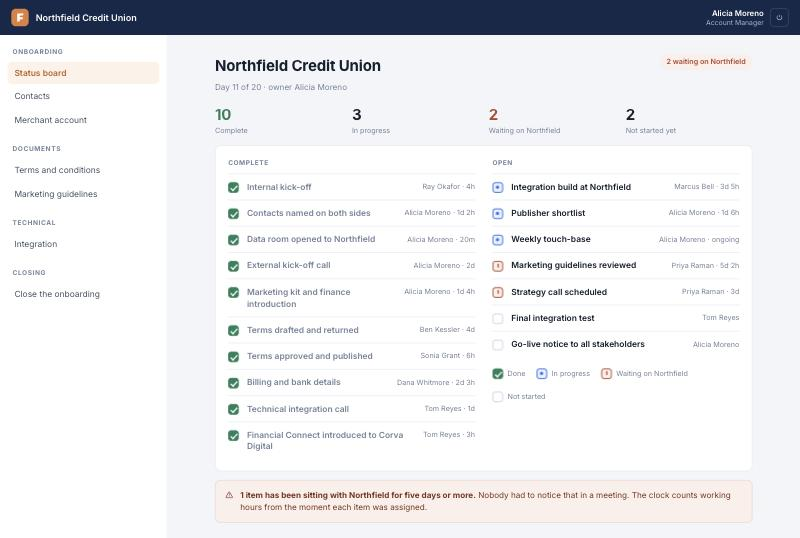
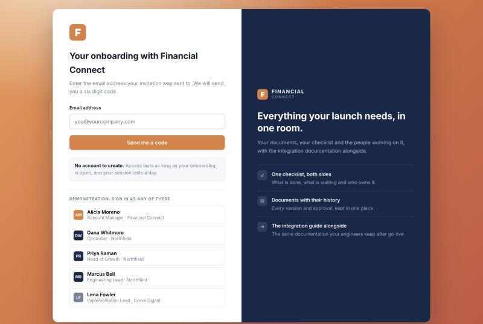

# Onboarding data room

A working prototype of the shared workspace a B2B customer lands in after they sign: one
checklist, the documents that go with it, the people on both sides, and a clock that nobody has
to maintain by hand.

Built as a demonstration of a workflow, not as a product. No backend, no build step, no
dependencies. Open it and it runs.



---

## The problem it is built around

Commercial teams close a deal and then spend three to six weeks chasing it into production. The
chasing is the expensive part, and almost none of it is technical:

- Nobody can say what stage the account is at without asking the account manager.
- The account manager cannot say either, without checking four email threads.
- Work stalls because a document went to somebody who was never going to be the right person.
- The record of how it went is reassembled afterwards, from memory, if at all.

The usual answer is a project management tool, which fails because the customer will not log into
yours. The answer here is a room the customer can enter with one email and a code, that shows
them only their own work, and that records timing as a side effect of people doing that work.

---

## What it does

**One checklist, two sides.** Seventeen items across four workstreams. Each carries an owner, how
long it has been open, and who is allowed to tick it off. Whoever owns an item can complete it;
everyone else can see where it stands, which is usually the question being asked.

**A gate that actually refuses.** Every workstream needs an owner on the vendor side and at least
one named person on the customer side. Until all four are satisfied nothing customer-facing
opens. This is enforced rather than described: remove the only customer contact from any
workstream and the button goes dead, the board warns, and the contacts page flips to blocked.

**Documents with their history.** Versions, who sent what and when, and the approval that
published the final text. One document is deliberately different: the guidelines the vendor's own
marketing team maintain are resolved at read time rather than copied, so the customer always sees
what is current. That distinction is load-bearing and is called out in the code.

**Role-scoped access.** Who you are decides what you see, and it is one application rather than
two. Staff get the status board and the controls. A finance contact sees billing and never sees
the integration build. An outside agency sees the one workstream it was introduced for.

**A closure that says what it will do.** Available only once every item is complete. It states
the three consequences before it commits them: the trail is rendered to a PDF, the files freeze
where they already sit, and the customer's contacts lose access.

---

## Running it

```bash
git clone https://github.com/tinasheadm/onboarding-data-room.git
cd onboarding-data-room
python3 -m http.server 8780
```

Then open <http://localhost:8780>. Opening `index.html` straight from the file system works too.

### Signing in



Email and a six digit code. No password, no account to create, no sign-up form. The panel lists
five people so you can get in without knowing the invented addresses; **any six digits are
accepted**, because there is no mail server behind a static page.

Everything else about the flow is what a real one would do, and the parts that matter are the
ones you cannot see: it refuses to confirm whether an unknown address belongs to the room, the
code expires, the resend is rate limited, and the session has a ceiling.

Try these two first, because they behave rather than merely render:

| Sign in as | Then |
|---|---|
| **Alicia Moreno**, Account Manager | Contacts, and remove the only customer contact from any workstream. The room closes. |
| **Marcus Bell**, Engineering Lead | Notice the sidebar: he has no finance, no legal, no closure. |

Reset to the starting state from the browser console with `resetRoom()`.

---

## How it is built

```
index.html          the shell: sign-in panel, top bar, sidebar, page host
assets/data.js      the room. One fictional customer, its people, items and documents
assets/app.js       sign-in, routing, and one function per screen
assets/styles.css   the design system
docs/               the seams where a backend plugs in
```

Plain ES5 and classic `<script src>` tags. No framework, no bundler, no `npm install`. That is a
deliberate constraint rather than an omission: the whole point of the artefact is that somebody
can open it, read it end to end in an afternoon, and see the shape of the workflow without
fighting a toolchain first.

State lives in `localStorage` under the `dataroom:` prefix. There is no server, so this
demonstrates a workflow; it is not a system of record. Every seam where a real backend would
attach is specified in **[docs/INTEGRATION-POINTS.md](docs/INTEGRATION-POINTS.md)**, including
the request and response shapes and, more usefully, the rules that have to move server-side
before any of it is real.

---

## The integration guide

The room's technical workstream indexes a separate documentation application and links out to it.
It does not hold a copy, which is the point: one source, two front doors, nothing to keep in step
and no access to withdraw after the customer goes live.

That companion application is not in this repository. Out of the box the integration page shows
the index and explains the arrangement rather than opening a dead tab. To wire it up, set one
line in `assets/app.js`:

```js
var PORTAL = {
  base: '../your-docs-app/index.html',   // empty means not configured
  param: 'from',
  token: 'dataroom'
};
```

The room signs the reader in at its own front door, so the query parameter tells the guide not to
ask a second time for one journey. **That parameter is a demonstration seam, not an
authentication boundary**, and swapping it for a signed, short-lived token is the first item in
the integration document.

---

## The demonstration data

One fictional customer, Northfield Credit Union, seeded at day 11 of a 20 day target. Every name,
address and domain is invented. No real company, person or deal appears anywhere in this
repository.

Day 0 is a `resetRoom()` away. The closed state is reachable by finishing the work.

---

## What this is and is not

It **is** a faithful model of the workflow: the roles, the gate, the scoping, the clock and the
closure all behave the way the real thing would.

It is **not** production software. There is no server, no authentication worth the name, no
persistence beyond one browser, and no multi-tenancy. The code says so where it matters rather
than leaving you to find out.

---

## Licence

MIT. See [LICENSE](LICENSE).
